<a href="https://sungwoojang.vercel.app">
  <picture>
    <source media="(prefers-color-scheme: dark)" srcset="./assets/header-dark.svg" />
    
  </picture>
</a>

  
  
  
  

I'm **Sungwoo Jang (장성우)**, a semiconductor science undergraduate at Dongguk University. I fabricate and characterize devices, then build AI agent workflows that connect device measurements, literature search, and experimental feedback to decide the next process condition. The same agent-based approach runs my patent analysis work.

**Now** — Undergraduate researcher at the Nano Optoelectronic Devices Lab, fabricating IGZO TFTs and using AI agents to explore process conditions.

### Selected Works

**01 · [IGZO TFT Process Optimization with AI Agents](https://sungwoojang.vercel.app/posts/igzo-tft-agent-process-development/)** &nbsp;`2026.05 – Present` 
Agents search papers and process history to propose the next recipe. Measured results feed back into the loop to narrow down process conditions.

**02 · [Campus Patent Universiade · Patent Consulting](https://sungwoojang.vercel.app/posts/cpu2026-patent-consulting/)** &nbsp;`2026.05 – 2026.08` 
Team lead for PolarBits. Screened about 4,000 ferroelectric memory patents for blocking patents, then proposed two new IP designs and a long-term patent strategy for a Korean memory company.

**03 · [AI-Assisted Two-Stage OTA Sizing Tool](https://sungwoojang.vercel.app/posts/ai-reverse-engineering-mosfet-parameter-extraction/)** &nbsp;`2026.02 – 2026.03` 
A lightweight MLP corrects the current error between MOSFET equations and process-model simulation, then sizes channel width and predicts gain, frequency response, and stability.

**04 · [MOSFET / TFT Characterization Tool](https://sungwoojang.vercel.app/posts/interactive-mosfet-tft-characterization-tool/)** &nbsp;`2025.11 – 2026.02` 
Parses voltage sweeps from measurement CSVs, plots transfer and output curves, and extracts Vth, SS, DIBL, and gm.

**05 · [CAPS · Automated Graduation Audit System](https://sungwoojang.vercel.app/posts/caps-graduation-audit/)** &nbsp;`2026.02 – 2026.03` 
Planning and QA for a rule-based graduation audit system built with the university's IT office, with requirement blocks that each department can configure.

More notes and write-ups at <a href="https://sungwoojang.vercel.app/blog/">sungwoojang.vercel.app/blog</a>

### Open Source

| Project | What it does |
| --- | --- |
| [**rea**](https://github.com/Qualop/rea) | Reverse engineer anything with agents, from app behavior down to native binaries. · [rea.tools](https://rea.tools) |
| [**inkleaf**](https://github.com/Qualop/inkleaf) | A quiet native Markdown writing app for macOS. |
| [**atrium-macos**](https://github.com/Qualop/atrium-macos) | CLI agent workspace for macOS with Korean UI, model discovery, and session recovery. |
| [**receipt-todo**](https://github.com/Qualop/receipt-todo) | A receipt-style task planner designed for people with ADHD. · [Live](https://receipt-todo.vercel.app) |
| [**artex-ko**](https://github.com/Qualop/artex-ko) | Korean localization of the ARTEX autonomous penetration testing framework. |

### Stack

<b>DEVICE &amp; CIRCUIT</b> 

<b>ANALYSIS &amp; AUTOMATION</b> 

<b>TOOLS</b> 

### Research Interests

- **Wearable displays** — flexible displays and oxide TFT backplanes; how process conditions shape mobility and threshold voltage.
- **Neuromorphic sensors** — device and circuit structures that process signals close to the sensor.
- **AI agents for semiconductor research** — extending measurement-to-recipe feedback loops to other devices and equipment.

---

Korean (native) · English (fluent) &nbsp;·&nbsp; <a href="https://sungwoojang.vercel.app/about/">About</a> &nbsp;·&nbsp; <a href="mailto:jangsw0117@gmail.com">jangsw0117@gmail.com</a>

